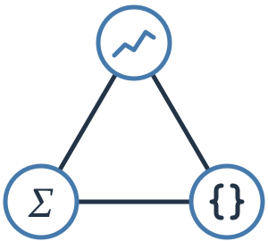

::: {.hero}
{.hero-logo fig-alt="demystR logo"}

::: {.hero-text}
# demystR {.unnumbered .unlisted}

Open the black box of statistical functions and models one step at a time. 
:::
:::

### Statistical fundamentals

::: {#fundamentals}
:::

### Computational modelling

::: {#modelling}
:::

## Acknowledgements

The style and structure of these books were inspired by the [PsyTeachR](https://psyteachr.github.io/) books from the University of Glasgow.
